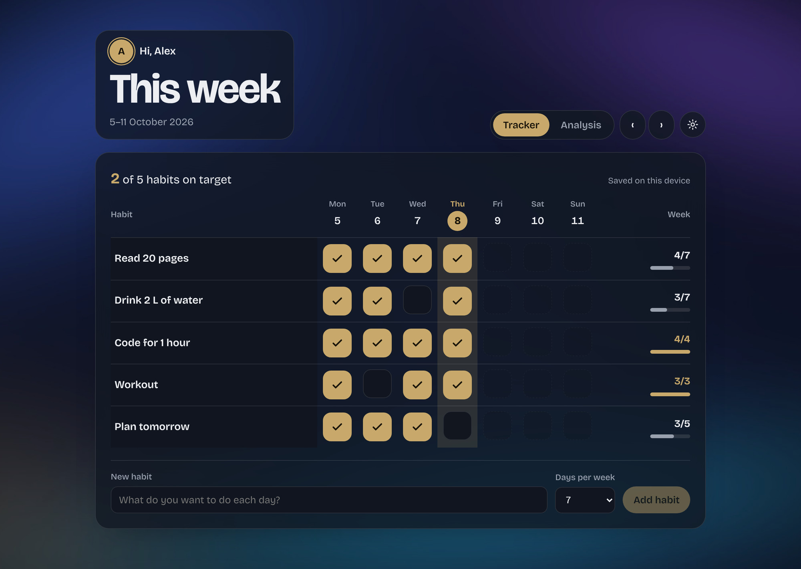
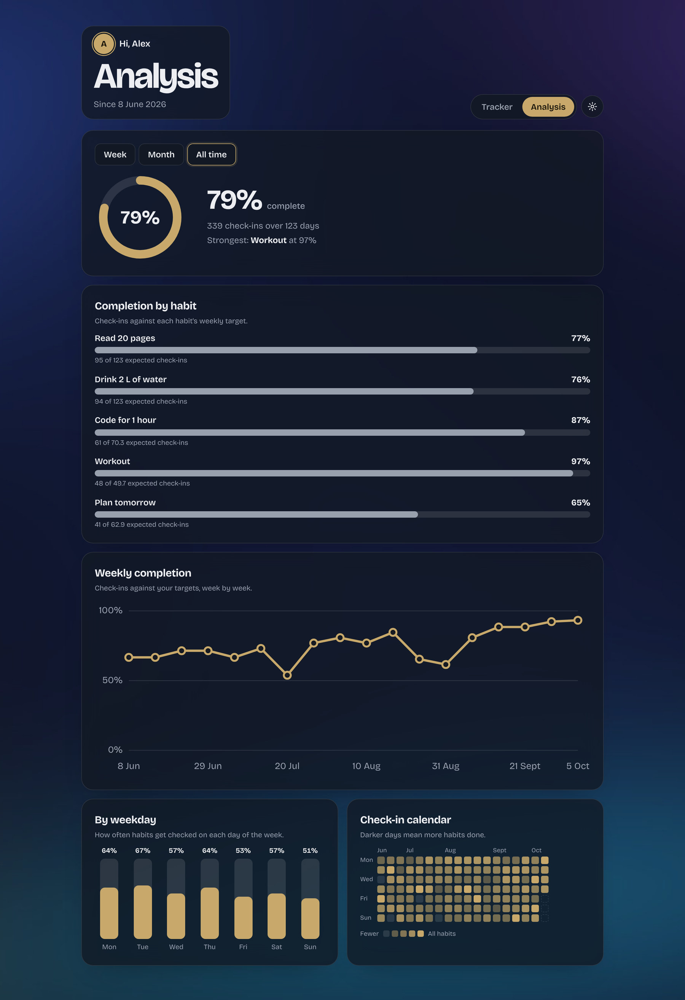
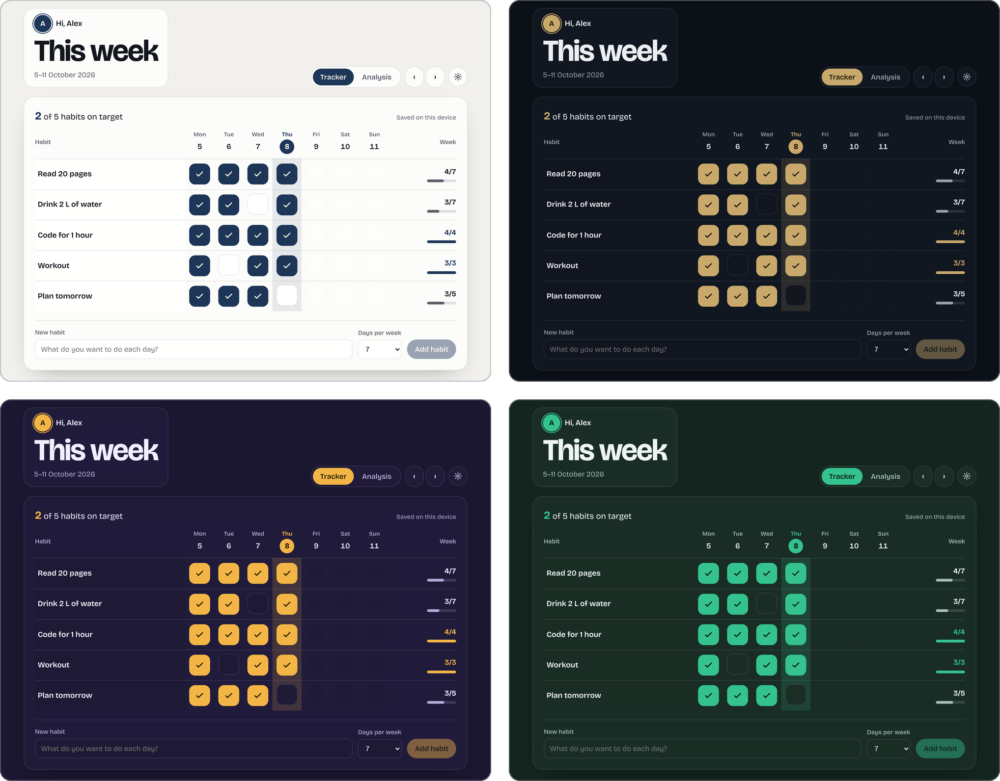
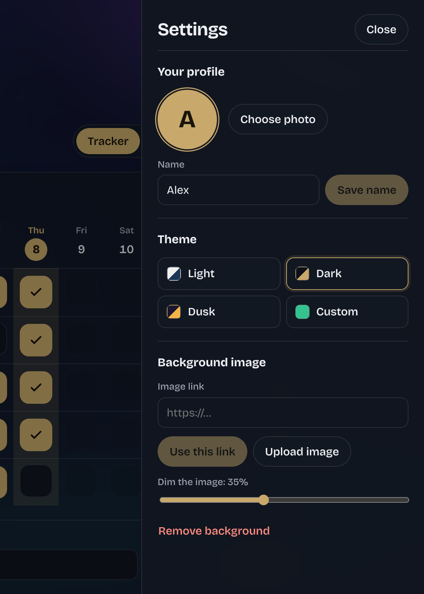
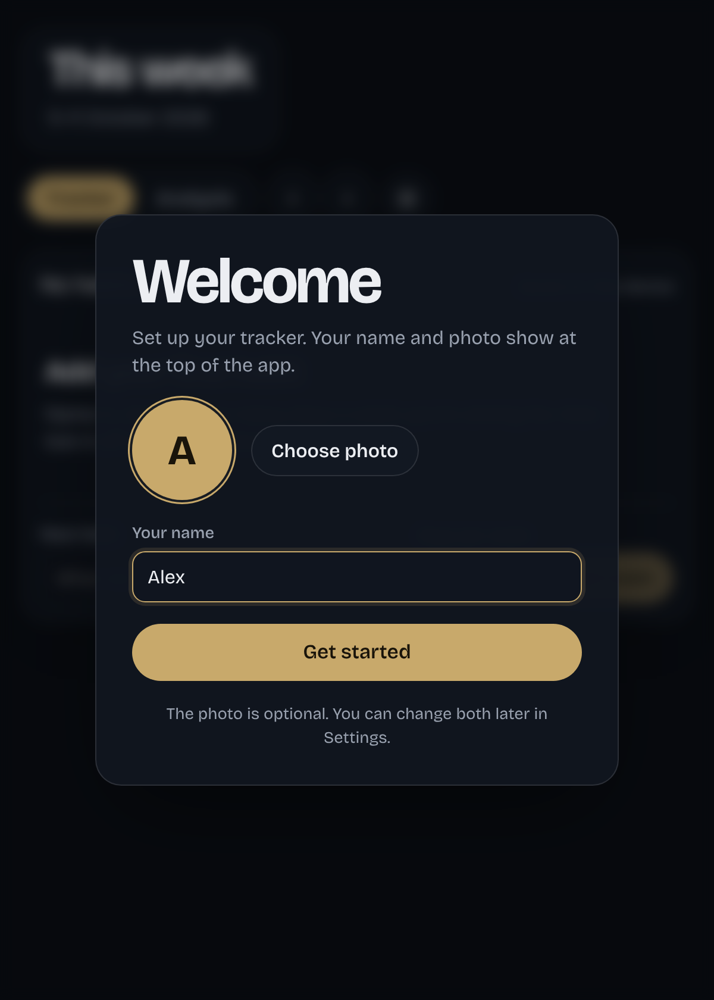

<p align="center">
  
</p>

<h1 align="center">Habit Tracker</h1>

<p align="center">
  A weekly habit tracker for Windows, with a built-in analysis of how consistent you have been.
</p>

<p align="center">
  <a href="https://github.com/THEHARVARDCLOWN/Personalised-Habit-Tracker/releases/latest">Download</a>
  &nbsp;·&nbsp;
  <a href="#features">Features</a>
  &nbsp;·&nbsp;
  <a href="#how-completion-is-calculated">How completion is calculated</a>
  &nbsp;·&nbsp;
  <a href="#build-from-source">Build from source</a>
</p>

<p align="center">
  
</p>

## Overview

Habit Tracker shows one week at a time. Every habit has a target of one to seven days a week, and ticking off a day takes a single click. The Analysis tab turns those check-ins into completion rates and charts for the week, the month, or everything since you started.

It runs as a portable Windows app with no installer and no account. Everything is stored on your computer.

## Features

### Tracking

- Habits with a weekly target of 1 to 7 days.
- A Monday to Sunday grid. Today is highlighted and future days are locked, so only days that have already happened can be ticked.
- Weekly progress for every habit (3/5, for example) and a count of habits that are on target.
- Click a habit's name to rename it, change its target or delete it. Deleting a habit also deletes its check-ins.
- Step through other weeks with the arrow buttons. The Today button takes you back.

### Analysis

- A Week, Month and All time switch.
- An overall completion ring with the number of check-ins and your strongest habit.
- Completion for each habit against its own weekly target.
- A trend line: daily in the Week view, weekly in Month and All time, and monthly once All time covers more than 26 weeks.
- The check-in rate for each day of the week.
- A calendar heatmap of the selected period.

### Appearance

- Four themes: Light, Dark, Dusk and Custom. Custom builds a full palette from a single accent colour. Until you pick a theme, the app follows your system's light or dark setting.
- A custom background from an image link or a file on your computer, with a dim slider from 0 to 85%.
- Translucent, blurred panels, so text stays readable over any image.

### Profile

- The first launch asks for your name and an optional photo. Photos are cropped to a square and scaled down to 320 px. Both can be changed later in Settings.

## Screenshots

All screenshots use sample data.

### Analysis



The All time view. The same page also shows a single week or the current month.

### Themes



Light, Dark, Dusk, and a Custom theme built from an emerald accent.

### Settings and first launch

<table>
  <tr>
    <td align="center" width="50%">
      <br>
      <sub>Settings: profile, theme and background</sub>
    </td>
    <td align="center" width="50%">
      <br>
      <sub>First launch: name and optional photo</sub>
    </td>
  </tr>
</table>

## Download

1. Download the portable `HabitTracker-<version>-portable.exe` from the [latest release](https://github.com/THEHARVARDCLOWN/Personalised-Habit-Tracker/releases/latest).
2. Double-click it. There is nothing to install.

It needs Windows 10 or later (64-bit) and is about 68 MB.

The app is not code-signed, so Windows SmartScreen may show "Windows protected your PC" the first time you run it. Choose **More info**, then **Run anyway**.

## How completion is calculated

Each habit has a weekly target. For any period, the expected number of check-ins is `target × days ÷ 7`, and a habit's completion is its check-ins divided by that number, capped at 100%.

For example, a habit with a target of 5 days a week, tracked over 14 days, expects 10 check-ins. Eight check-ins is 80%.

The overall figure adds up each habit's capped check-ins and divides by the total expected, so a habit that goes past its target does not make up for another that falls short. A habit counts from the day it was added, so earlier days never count against you.

The weekday chart and the calendar are simpler: they show the share of active habits that were ticked on each day, with no targets involved.

## Your data

Habits, check-ins, settings, your name, and any photo or background you upload are stored on your computer in `%APPDATA%\Habit Tracker`. Nothing is sent to a server.

The app makes two kinds of network request. It loads its typeface (Bricolage Grotesque) from Google Fonts, and it fetches a background image when you paste a link. Offline, the typeface falls back to the system font and everything else works as normal.

Only one window can run at a time, so two copies never write to the same data.

## Build from source

You need [Node.js](https://nodejs.org) 18 or newer.

```bash
git clone https://github.com/THEHARVARDCLOWN/Personalised-Habit-Tracker.git
cd Personalised-Habit-Tracker
npm install
npm start       # build the page and open the app
npm run dist    # build dist/HabitTracker-<version>-portable.exe
```

`npm run dist` produces a 64-bit Windows build.

## Project structure

```
.
├── src/
│   ├── app.jsx            React app: tracker, analysis, settings and profile
│   └── shell.html         Page markup and all styles
├── scripts/
│   └── build-html.js      Compiles app.jsx and inlines React into app/index.html
├── main.js                Electron main process: window and single-instance lock
├── build/                 App icon
├── docs/screenshots/      Images used in this README
└── package.json
```

## Built with

React 18, Electron 31, esbuild and electron-builder. React is bundled into the page, so the app has no runtime dependencies and loads straight from disk.

## License

MIT. See [LICENSE](LICENSE).
